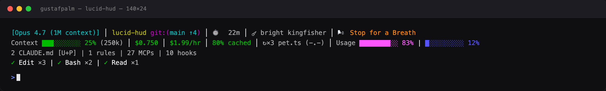

# Lucid HUD

A Claude Code plugin that shows what's actually happening in your session — context usage, **session cost**, **cache hit ratio**, **efficiency colors**, active tools, running agents, and todo progress. Always visible below your input.

> **Lucid HUD is a fork of [`jarrodwatts/claude-hud`](https://github.com/jarrodwatts/claude-hud)** by Jarrod Watts (MIT). It adds **context intelligence**: real-time cost from the Claude Code stdin payload, cache hit ratio, and color-coded efficiency zones that surface when a `/compact` would actually save you money. All credit for the core HUD architecture goes to Jarrod — please ⭐ star the upstream too.

[](LICENSE)
[](https://github.com/gpalmgg/lucid-hud/stargazers)



## Install

Inside a Claude Code instance:

**Step 1: Add the marketplace**
```
/plugin marketplace add gpalmgg/lucid-hud
```

**Step 2: Install the plugin**

<details>
<summary><strong>⚠️ Linux users: Click here first</strong></summary>

On Linux, `/tmp` is often a separate filesystem (tmpfs), which causes plugin installation to fail with:
```
EXDEV: cross-device link not permitted
```

**Fix**: Set TMPDIR before installing:
```bash
mkdir -p ~/.cache/tmp && TMPDIR=~/.cache/tmp claude
```

Then run the install command below in that session. This is a [Claude Code platform limitation](https://github.com/anthropics/claude-code/issues/14799).

</details>

```
/plugin install lucid-hud
```

**Step 3: Configure the statusline**
```
/lucid-hud:setup
```

After setup, restart Claude Code and the HUD appears below your input.

## What you see

```
[Opus 4.7 (1M context)] │ gustafpalm │ ⏱️  2m │ 🌬️ session-name
Context █░░░░░░░░░ 8% (84k) │ $0.703 │ 97% cached │ Usage ████████░░ 83% (resets in 3h 38m) │ █░░░░░░░░░ 12% (resets in 2d 10h)
1 CLAUDE.md │ 1 rules │ 27 MCPs │ 10 hooks
✓ Bash ×11
```

The cost, cache ratio, and efficiency-tinted bar are the lucid-hud additions on top of the upstream HUD.

### Efficiency zones

The context bar, cost, and cache ratio are tinted by an efficiency heuristic so the HUD itself nudges you toward `/compact` when it'd actually save money:

| Condition | Color | Meaning |
|-----------|-------|---------|
| Context <40% OR (Context <60% AND cache >80%) | Green | Lean and efficient |
| Context 40–60% AND cache <80% OR Context 60–80% | Yellow | Getting heavy |
| Context >60% AND cache <70% OR Context >80% | Red | Compact would save money |

## Configuration

Run `/lucid-hud:configure` to toggle optional rows (tools, agents, todos, session info). Or edit `~/.claude/plugins/lucid-hud/config.json` directly.

### Context intelligence (the fork's headline)

- `display.showCost` — session cost from Claude Code's `cost.total_cost_usd`
- `display.showCacheRatio` — cache hit ratio from `cache_read / total`
- `display.showReclaimable` — adaptive reclaimable-token estimate (default **on**)
- `display.reclaimableThreshold` — minimum tokens before showing (default `20000`)
- `display.showBurnRate` — `$X.XX/hr` rate next to total cost

### Session intelligence

- `display.showCompactNudge` — after a few compacts, learns your personal threshold and whispers `↘ past avg 73%` when the current session exceeds it. The ledger learns silently in the background even when this toggle is off.
- `display.showStuck` — whispers `↻×3 file.ts` when the same file has been edited 3+ times in a row
- `display.showActiveClaudeMd` — annotates the CLAUDE.md count with which scopes are load-bearing: `3 CLAUDE.md [U+P]` (user + project)

### Ambient personality

- `display.showPet` — a tiny ASCII creature at line-end whose mood mirrors session state: `(-.-)` sleepy / `(o.o)` alert / `(x.x)` sick / `(^_^)` happy
- `display.showDaemon` — a session-scoped spirit-animal name like `🜚 amber otter`, deterministic from session id and persisted across resumes

### Layout

- `lineLayout: "compact"` — collapses everything into a single dense line for narrow terminals
- `lineLayout: "expanded"` — default multi-line layout with identity, usage, environment, and optional activity rows

**Feature ideas** for anyone forking: see [`docs/feature-ideas.md`](docs/feature-ideas.md) for a menu of sensible upgrades and surprise features to pull from.

## Credits

- **Jarrod Watts** ([@jarrodwatts](https://github.com/jarrodwatts)) — author of [`claude-hud`](https://github.com/jarrodwatts/claude-hud), the upstream this fork is built on. Everything that's good about the rendering, transcript parsing, plugin scaffolding, and cross-platform setup story is his work.
- **Gustaf Palm** ([@gpalmgg](https://github.com/gpalmgg)) — context intelligence fork (cost, cache ratio, efficiency colors).

## License

MIT — see [LICENSE](LICENSE). Both the upstream and the fork modifications are MIT.
